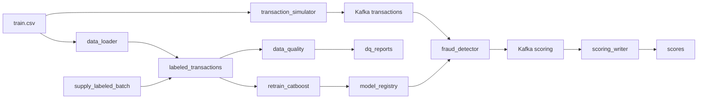

# Антифрод: поток транзакций, скоринг и переобучение

Сервис читает транзакции из Kafka, считает скор CatBoost и пишет в ответ `score`, `fraud_flag` и `model_version`. Airflow по расписанию дописывает размеченный месяц, переобучает модель на скользящем окне и публикует бинарник в каталог, который скоринг перечитывает без перезапуска.

Нужен размеченный `train.csv` соревнования [teta-ml-1-2025](https://www.kaggle.com/competitions/teta-ml-1-2025/data): 18 колонок от `transaction_time` до `target`, период с января 2019 по март 2020.

## Архитектура



| Сервис | Роль |
|--------|------|
| Kafka, Zookeeper, Kafka UI | Топики `transactions` и `scoring` |
| transaction_simulator | Случайные строки CSV в `transactions`, новое время и новый `transaction_id` |
| fraud_detector | Препроцессинг и CatBoost. Перед каждым сообщением читает `model_registry/latest.txt` и подхватывает `my_catboost_<версия>.cbm` |
| scoring_writer | Пишет `score`, `fraud_flag`, `model_version` в PostgreSQL |
| data_loader | Один раз грузит CSV в витрину и собирает стартовое окно январь–апрель 2019 |
| airflow | Три DAG каждые 5 минут |

Каталог `model_registry/` смонтирован в Airflow как `/opt/airflow/models` и в `fraud_detector` как `/models`. Отчёты качества лежат рядом, в `dq_reports/` (`/opt/airflow/dq_reports`). Логика задач в `pipeline/`, файлы в `dags/` только собирают граф.

## Параметры

| Параметр | Значение |
|----------|----------|
| Окно обучения | 4 месяца. Новый месяц входит, самый старый выходит |
| Train / test | Все месяцы окна, кроме последнего, идут в обучение. Самый свежий месяц — контроль. Случайного split нет |
| Батч поставки | 80 000 строк |
| Глубина истории витрины | 3 года от месяца `max(transaction_time)` |
| Расписание | `*/5 * * * *`, `catchup=False`. Пропущенные запуски не догоняются |
| Стартовая модель | Окно январь–апрель 2019, контроль — апрель, версия `initial` |

Витрина из CSV уже содержит месяцы по март 2020. Первое переобучение забирает май 2019. Поставка синтетического месяца начинается с апреля 2020: берётся случайная выборка уже лежащих строк, `transaction_time` переносится в следующий календарный месяц, день и час сохраняются, лишний день обрезается до конца месяца.

Указатель `training_state.next_batch_month` меняется только в задаче `publish_model`, после того как файл `.cbm` уже лежит в `model_registry/`. Границы окна записываются абсолютно по месяцу батча, поэтому повтор упавшей публикации не перескакивает месяц и не сдвигает окно второй раз. Поставка месяца пишет маркер в `supplied_months` в той же транзакции, что и строки: повтор задачи этот месяц не дублирует.

## Препроцессинг

Функция `run_preproc` в `fraud_detector/src/preprocessing.py` одна и для обучения, и для потока. Статистики по train не считаются.

Категории для CatBoost: `merch`, `cat_id`, `gender`, `one_city`, `us_state`, `jobs`, `daypart`.

Числовые признаки:

- `amount`, `log_amount` — сумма и её логарифм
- `distance_km`, `lat_delta`, `lon_delta` — расстояние до мерчанта и сдвиг координат
- `hour_sin`, `hour_cos`, `dow_sin`, `dow_cos` — циклические час и день недели
- `log_population` — логарифм населения города
- `is_night` — час с 0 до 5
- `is_far` — расстояние больше 100 км

`daypart` — `night` / `morning` / `day` / `evening`. Имя, фамилия и улица в модель не входят. Сырые широта, долгота, индекс и календарные год/месяц/день/минута тоже не входят.

## Гейт раскатки

Задача `evaluate_candidate` сравнивает кандидата с моделью, которая сейчас указана продом.

Считается ROC-AUC на самом свежем месяце окна. Это тот же временной контроль, на котором учится ранняя остановка. F1 при пороге 0.5 тоже считается и пишется в `my_catboost_<версия>.metrics.json`, но релиз по нему не режется: в данных около 0,57% фрода, и F1 на фиксированном пороге сильно прыгает между месяцами.

Решение:

- если у прода ещё нет ROC-AUC, кандидат становится продом;
- если ROC-AUC кандидата **ниже** значения в `model_registry/prod_metrics.json`, модель в прод не переключается;
- если ROC-AUC не ниже, обновляются `latest.txt` и `prod_metrics.json`.

Файл `my_catboost_<версия>.cbm` сохраняется в обоих случаях. Скоринг читает только версию из `latest.txt`, поэтому отклонённая модель на поток не попадает. Окно и указатель месяца всё равно сдвигаются: иначе один и тот же месяц переобучался бы бесконечно. Пока гейт не пропустил кандидата, в `scores.model_version` остаётся прежняя версия.

## Data Quality

DAG `data_quality` не меняет витрину. Он считает агрегаты по `labeled_transactions`, сверяет их с правилами и пишет HTML. Провал правила не роняет DAG: статус виден в отчёте `dq_reports/latest.html`.

| Правило | Порог |
|---------|--------|
| `required_fields_complete` | Пустые `transaction_time`, `amount`, `target`, `merch`, `cat_id` — не больше 0,1% строк, витрина не пустая |
| `target_binary` | `target` только 0 или 1 |
| `amount_in_range` | `amount <= 0` или `amount > 100000` — не больше 0,1% строк |
| `coordinates_in_range` | Широта в [-90, 90], долгота в [-180, 180] у клиента и мерчанта, нарушений не больше 0,1% |
| `event_time_plausible` | Время в полуинтервале [2018-01-01, 2100-01-01) |
| `fraud_rate_in_band` | Доля `target = 1` от 0,1% до 5% |
| `gender_domain` | Значения вне `{F, M}` — не больше 0,5% |
| `state_code_format` | `us_state` не совпал с `^[A-Z]{2}$` — не больше 1% |

## Как запустить

Нужны Docker и Docker Compose.

```bash
cp .env.example .env
```

В `.env` укажите абсолютный путь к `train.csv` в `TRAIN_DATA_CSV`.

```bash
docker compose up --build
```

Первый запуск скачивает образы и загружает витрину. Это занимает несколько минут. `data_loader` завершается сам, Airflow стартует после него.

Повторный `docker compose up` без `down -v` витрину заново не грузит и окно обучения не сбрасывает.

## Где смотреть

| Что | Куда |
|-----|------|
| Airflow | http://localhost:8081 (`admin` / `admin`) |
| Kafka UI | http://localhost:8080 |
| PostgreSQL | `localhost:5432`, база `fraud_db`, пользователь `fraud_user`, пароль `fraud_pass` |
| Модели | каталог `model_registry/` |
| DQ-отчёт | `dq_reports/latest.html` |

В Airflow три DAG: `supply_labeled_batch`, `retrain_catboost`, `data_quality`. Они не на паузе и сами запускаются раз в 5 минут. Кнопка Trigger запускает прогон сразу, не дожидаясь расписания.

## Как проверить, что скоринг идёт опубликованной моделью

1. Дождитесь сообщений в топике `scoring` (Kafka UI) или строк в `scores`. В сообщении есть `transaction_id`, `score`, `fraud_flag`, `model_version`. До первой успешной раскатки версия — `initial`.
2. В Airflow откройте `retrain_catboost` и нажмите Trigger. В графе должны быть задачи `extract_month_batch` → `slide_training_window` → `time_train_test_split` → `preprocess_dataset` → `fit_catboost` → `evaluate_candidate` → `publish_model`.
3. После успеха в `model_registry/` появляется `my_catboost_<версия>.cbm` и рядом `my_catboost_<версия>.metrics.json`. В json есть `roc_auc`, `f1`, `promoted` и `gate_reason`.
4. Если `promoted` равен `true`, `model_registry/latest.txt` содержит эту версию. Новые строки `scores` получают её в `model_version` без перезапуска `fraud_detector`. Если `promoted` равен `false`, файл модели на диске есть, а `latest.txt` и скоринг остаются на прежней версии.

```bash
docker compose exec postgres psql -U fraud_user -d fraud_db -c \
  "SELECT model_version, count(*) FROM scores GROUP BY 1 ORDER BY 2 DESC;"
```

```sql
SELECT transaction_id, score, fraud_flag, model_version, created_at
FROM scores
ORDER BY created_at DESC
LIMIT 20;
```

```sql
SELECT window_start, window_end, next_batch_month FROM training_state;
```

Поставка месяца: Trigger на `supply_labeled_batch`. Задачи `sample_next_month` → `append_labeled_batch` → `prune_old_months`. Новый месяц виден так:

```sql
SELECT date_trunc('month', transaction_time)::date AS month, count(*)
FROM labeled_transactions
GROUP BY 1
ORDER BY 1 DESC
LIMIT 5;
```

Проверка качества: Trigger на `data_quality`, затем откройте `dq_reports/latest.html`.

## Очистка

`docker compose down -v` удаляет контейнеры, витрину Postgres и состояние Airflow. Каталоги `model_registry/` и `dq_reports/` остаются на диске. Чтобы начать со стартовой модели, остановите контейнеры и очистите содержимое `model_registry/`, кроме самого каталога: при следующем старте туда снова копируется версия `initial`.
